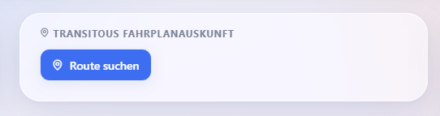
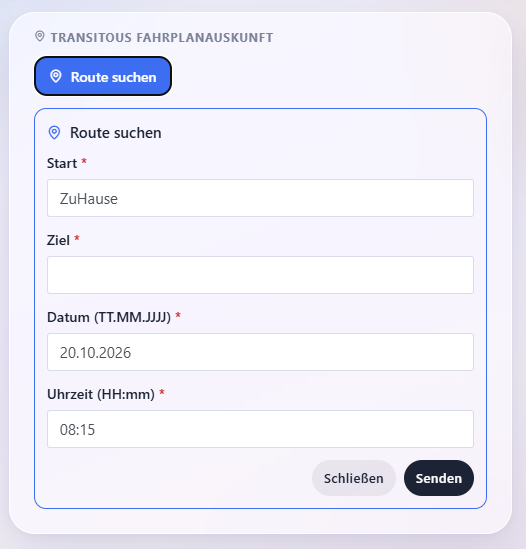
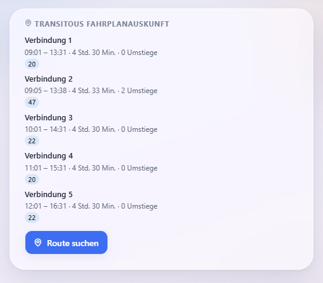
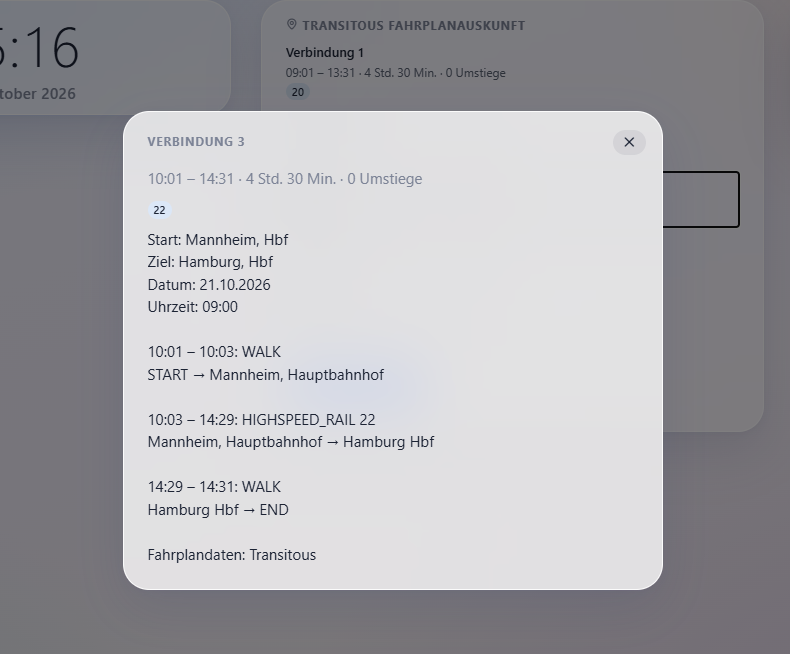

# Intégration du routage transitoire

## Il vous faut :

Gladys Assistant > Version 5.2

Intégration externe - Routage transitoire

Accès à Internet pour votre installation de Gladys Assistant

## Vous obtenez :

Grâce à ses dimensions compactes et à sa présentation claire, cette application vous permet de consulter facilement et rapidement les horaires du monde entier.

Cette intégration vous permet de consulter facilement les horaires de Gladys Assistant.
Exemple :

Après avoir cliqué sur le bouton :

une fenêtre s'ouvre avec les champs de recherche :

Le champ « Départ » est prérempli avec votre adresse personnelle dans Gladys. Reportez-vous à la section « Configuration » pour plus de détails. Vous pouvez modifier cette valeur.

La destination s'indique juste en dessous.

La date au format JJ - MM - AAAA, par exemple : 21.10.2026.

Enfin, l'heure au format HH-mm : 22:23.
Cliquez sur « Envoyer » pour récupérer les horaires :

Cette liste vous donne un premier aperçu des horaires trouvés. Parallèlement, vous verrez s'afficher, à titre indicatif, le prochain moyen de transport à emprunter pour chaque itinéraire, identifié par un code couleur pour plus de facilité.
Si vous cliquez maintenant directement sur l'un des itinéraires affichés, vous pourrez consulter les informations détaillées :

## Configuration

1.    Installez l'intégration externe soit via Gladys Assistant (recommandé) soit dans Gladys Assistant avec un accès direct à GitHub.
  
2.    Une fois l'installation terminée, vérifiez que l'intégration fonctionne correctement.

3.    Ouvrez votre tableau de bord, passez en mode Édition, puis ajoutez-y le nouveau widget.Sélectionnez ce widget d'intégration.
  
4.    Lors de l'ajout du widget à votre tableau de bord, vous devrez fournir certaines informations :
  
a.) Votre géolocalisation comme point de départ (ou choisissez un emplacement dans Gladys Assistant)
b.) L'intervalle de rafraîchissement, par tranches de 10 minutes.
c.) Un identifiant unique pour l'accès à l'API sur https://transitous.org/. Cet identifiant doit être unique ; il peut s'agir, par exemple, d'une adresse e-mail ou d'un site web. Il est stocké par l'intégration uniquement dans le champ de configuration prévu à cet effet. L'intégration ne récupère ni ne consigne cet identifiant. Tout reste entre vos mains. Transitous.org utilise cet identifiant pour gérer la charge sur son infrastructure informatique. Tenez compte du fournisseur de données lorsque vous définissez ce paramètre. Nous recommandons une durée de 15 minutes.

6.    Une fois ces informations renseignées, enregistrez-les et placez le widget à l'endroit de votre choix.

## Dépannage

L'intégration consigne toutes ses opérations : consultez les journaux d'intégration depuis l'
interface utilisateur de Gladys (ou via la commande `docker logs` sur l'hôte) avec l'option `LOG_LEVEL=debug` pour obtenir tous les
détails.
